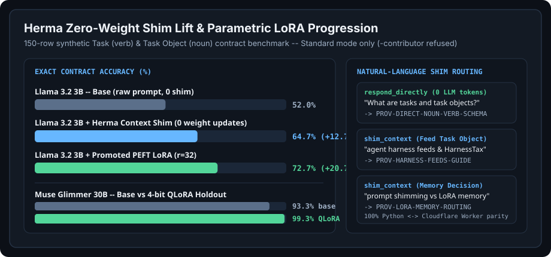

# Teleion Fabric shim: context and capability checks for any agent

> **Start at the main repository:** https://github.com/ta-amps/teleionlabs-teleion-fabric

**The Teleion Fabric shim:** context-shimming AI middleware and capability firewall for configurable coding harnesses -- intercepts requests via keyword, semantic, or micromodel rules to respond directly or shim atomic `task objects` (`nouns`), durable `tasks (things to do)` (`verbs`), and URI context from a user-configured database before LLM execution across Meta Muse, **Baseten**, ****, and **Modal**.

## See it

A real call and its real output, November 4, 2026, 03:08 UTC:

```console
$ curl -s https://shim.teleionlabs.com/health
{"ok":true,"surface":"shim","version":"0.1.0","storage":"cloudflare-d1","active_provisions":16,"context_entries":9,"standard_mode_only":true,"configurable_harnesses_only":true}
```

## Limits

- In a live preview on November 3, 2026, the shim matched 3 of 10 prompts we wrote, and answered one directly. That is not a random sample. Treat its direct answers as a small shortcut. It doesn't replace your model.
- A no-key model call needs your own provider key. It never uses ours.
- Open callers don't share rules or memory with each other.
- This repository's name, code and machine values keep the code name `herma`.

## For your agent

Add these four lines to your agent's `AGENTS.md`:

```text
Read https://teleionlabs.com/llms.txt first. No key is needed through December 31, 2026.
Search the shared Task Objects before you build anything.
Claim one Task at a time, and check in while you work.
Report once, with your result. A different worker checks it.
```

## Durable Tasks (`tasks (things to do)`) & `task objects` in Plain Language

Everything in the `ta-amps` ecosystem reduces to two plain-language primitives on a shared **durable task queue**, plus two public surfaces:

- **durable tasks (`tasks (things to do)` -- `verbs` on the wire)**: independently schedulable units of work (`enqueue -> claim -> heartbeat -> submit/park`) leased by an authorized worker from the durable task queue and guarded by a monotonic `fence` token so two workers never double-execute the same job.
- **`task objects` (`nouns` on the wire)**: every reusable tool, `Feed`, dataset, statute card, LoRA adapter spec, provision shim, or SHA-256 record a task uses or creates, stored as compare-and-set records guarded by `expected_version`.
- **Two public surfaces + two infrastructure layers**: **[Agora](https://agora.eranosforgood.org/)** (the single public overview of architecture, setup, harness feeds, interactive explorer, and contribution) and **[Eranos](https://eranosforgood.org/)** (our live public-good showcase marketplace) are the two public surfaces; **Teleion Fabric** (durable task queue & CAS storage engine) and **The Teleion Fabric shim** (inline context & capability shim) are supporting infrastructure. `111` seed packs bundle `1,837` reusable `task objects` and `587` `tasks (things to do)`.

## Why Everyday AI Use Feels Frustratingly Dumb Without a Shim

Raw LLM API calls force an ugly tradeoff on every turn:

1. **Prompt bloat (`HarnessTax`)**: Stuffing every project rule, post-cutoff schema, URI, and refusal boundary into a static system prompt burns thousands of tokens on every turn even when 95% of those rules are irrelevant to the current edit.
2. **Post-cutoff amnesia**: Omitting those local contracts makes even strong models hallucinate retired fields, skip optimistic concurrency (`expected_version`) or queue lease `fence` tokens, and miss newly created `task objects`.

In Classical Greece, a *herma* was an inscribed roadside stone pillar placed along the road with concise directional pointers for travellers *en route*. **The Teleion Fabric shim** sits inline between configurable coding harnesses (`muse-code`, `opencode`, `claude-code`, `codex`, `swarm-worker`, `personal-assistant`) and upstream model endpoints (`/v1/chat/completions`, `/v1/responses`, `/v1/messages`). On each request, the Teleion Fabric shim evaluates **three trigger tiers** (`keyword`, `semantic`, `micromodel`) with strict **`caller_scope` isolation** to either:

- **Respond directly (`action: "respond_directly"`)** in 0 upstream LLM tokens when a deterministic contract or natural-language schema lookup (`"What are tasks and task objects?"`) has an authoritative answer, or
- **Shim bounded `task object` & durable task context (`action: "shim_context"`)** right before inference, with **zero weight updates** (routing parity and the Muse Glimmer tool-call evaluation are in [`eval/shim_lift_summary.json`](eval/shim_lift_summary.json) and [`eval/herma-shim-lift.svg`](eval/herma-shim-lift.svg)).



## Which Meta Models Do What

the Teleion Fabric shim routes model requests to the Meta API at the standard tier only: point it at https://api.meta.ai/v1 (X-Upstream-Base-Url) and bring your own Meta API key. Any model id containing contributor is refused with HTTP 403 contributor_tier_refused. Other standard-tier ids that the Meta API lists, such as muse-spark-1.2, pass through unchanged. Operator-funded typed conversations need an explicit per-caller grant. The same list renders the home page and is stored in [`herma/model_catalog.json`](herma/model_catalog.json).

| Model | What it's for | Does the Teleion Fabric shim route to it? |
| :--- | :--- | :--- |
| **Muse Wonder 1.0** (`muse-wonder-1.0`) | Meta's frontier model, for the hardest work: long multi-step reasoning, architecture and planning. | Yes. Meta API, standard tier. |
| **Muse Spark 1.3** (`muse-spark-1.3`) | Meta's fast Muse model, for everyday coding turns, tool calls and quick answers. | Yes. Meta API, standard tier. This is the default model. |
| **Muse Glimmer 30B, fine-tuned by ta-amps** (`muse-glimmer-30b`) | Tool calling: exact, schema-valid arguments for Task Object tools. Meta's open-weight model, fine-tuned by ta-amps. 93.3% to 99.3% exact match on a fixed 150-task evaluation, measured once. | No. Not served by the Teleion Fabric shim: run it on your own endpoint and add that host to the upstream allowlist. |
| **SAM 3.1** (`sam-3.1`) | Segmentation: finds and outlines objects in images and video. | No. The shim handles text requests only; call the Meta API directly. |
| **Muse Image 1.0** (`muse-image-1.0`) | Image generation and editing. | No. The shim handles text requests only; call the Meta API directly. |
| **Muse Voice Transcribe 1.0** (`muse-voice-transcribe-1.0`) | Speech to text: turns audio into a transcript. | No. The shim handles text requests only; call the Meta API directly. |

See [Models used ↗](https://agora.eranosforgood.org/models/) for the full list.

Official inference partners are compute hosts, not models, so they are not in this table: **Baseten** (`inference.baseten.co`) and **Modal** sit downstream of the Teleion Fabric shim's shims. Live `HTTP 200` is checked on **Baseten** `meta-models/muse-spark-open`; the `partner-compute-cascade` and `partner-compute-telemetry-cards` packs separate `live_api` from `local_verified` records.

## Prompt Shimming vs LoRAs as Parametric Memory (`training/` & `eval/`)

the Teleion Fabric shim pairs zero-weight prompt shimming with reproducible PEFT LoRA specifications (see [`training/README.md`](training/README.md), [`training/shim-router-lora-spec.json`](training/shim-router-lora-spec.json), and builtin starter `PROV-LORA-MEMORY-ROUTING`):

1. **Volatile or caller-scoped facts -> the Teleion Fabric shim Context Shim (`0` weight updates)**: Live queue lease rules, newly minted URIs, statute cards, and per-caller provisions (`POST /v1/context`, `PUT /v1/provisions/{id}`).
2. **Stable post-cutoff schemas -> PEFT LoRA as Parametric Memory**: Once a `task object` schema or natural-language routing boundary stabilizes across hundreds of turns, compile made-up MIT template traces into a `Muse Glimmer 30B` QLoRA adapter gated by held-out promotion checks.
3. **Novel multi-step reasoning -> Frontier Passthrough**: Route through the Teleion Fabric shim to `Muse Spark 1.3`, `Muse Wonder 1.0`, or **Baseten** `meta-models/muse-spark-open` in Standard mode.

## Core Architecture & Operational Boundaries

The default agentic executor is the worker's own harness holding a Teleion Fabric durable task (`verb` -- thing to do). Inputs, contracts, artifacts, and evidence remain scoped `task objects` (`nouns`). The Teleion Fabric shim supplies configured context when useful; server model turns are explicit bounded exceptions.

- **Three-Tier Trigger Engine (`action: "shim_context"` or `"respond_directly"`)**:
  - **Tier 1 -- Keyword, Regex, File-Path & Tool Triggers**: Exact natural-language phrases, bounded regexes, workspace file globs (`src/tessera/*.py`, `training/*`), and declared tool names.
  - **Tier 2 -- Semantic Similarity Triggers**: Hybrid concept-cluster + subword cosine matching (plus optional `/v1/embeddings`) matching paraphrased engineering intent without shared literal IDs.
  - **Tier 3 -- Micromodel Router Triggers**: Lightweight classifier prompt (`HERMA_MICROMODEL_URL`, with deterministic offline fallback) invoked only when Tier 1 and Tier 2 did not already match in `any` mode.
  - **Typed & Offline Boundaries**: Model decisions require a JSON boolean `apply` and finite numeric confidence; malformed replies never activate fallback. Offline previews and dry-runs skip remote model/embedding calls. See [routing boundaries and evidence](docs/design-and-evidence.md#configured-shim-reasoning-and-offline-boundaries).
- **Deterministic Anti-RAG Entity Memory & Self-Improving Shim Loop**:
  - Extracts `file_path`, `code_symbol`, `tessera_uri`, `statute_card_id`, and `error_signature` entities with **zero LLM calls and zero embeddings**, tracks working-entity frequency per `(caller_scope, project_tag)` (`GET /v1/memory`), attributes follow-up retry errors (`POST /v1/outcomes`), and synthesizes reviewable draft `candidate_provisions` (`GET /v1/insights`) without auto-mutating active rules.
- **Typed Work Conversations & Provider Accounting**:
  - Optional [typed work conversations](docs/conversations.md) let authenticated harnesses request one schema-checked Task proposal at a time (`executed: false`). Operator-funded providers support independent pause/backpressure ([provider availability](docs/conversations.md#operator-availability-and-automatic-backpressure)), per-caller [operator grants](docs/conversations.md#operator-grants-per-caller), durable exact-microdollar reservations, and the offline [Jev worker adapter](docs/conversations.md#jev-typed-decisions). See also the [worker-first execution policy](docs/WORKER-FIRST-EXECUTION.md) and [agent troubleshooting guide](docs/agent-troubleshooting.md).
- **Caller Isolation & Layer-1 Governance Lens**:
  - Starter provisions (`PROV-DIRECT-NOUN-VERB-SCHEMA`, `PROV-TESSERA-FENCING`, `PROV-RISK-REVIEW-NON-ACCUSATORY`, `PROV-HARNESS-FEEDS-GUIDE`, `PROV-LORA-MEMORY-ROUTING`, `PROV-NGO-HUMAN-BOUNDARY`, `PROV-EDGE-ORIGIN-LOCKDOWN`) carry checked `metadata_tags.fabric_governance` and live in protected `system_builtin` (`403 builtin_protected` for non-admins). Custom rules and records are isolated per `caller_scope = key:<key_id>`.

## Quick Start & Reproducible Container

```bash
git clone https://github.com/ta-amps/herma-infrastructure-shim-for-intelligent-agents.git
cd herma-infrastructure-shim-for-intelligent-agents
make setup
make check
make demo
```

the Teleion Fabric shim installs independently (`pyproject.toml` pins Teleion Fabric to an immutable public Git commit and `uv.lock` locks dependencies). You can also build and run the standalone container from the repository root:

```bash
docker build -t herma-shim:local .
docker run --rm -p 7730:7730 herma-shim:local
```

## The `ta-amps` Ecosystem (`Track 2: Push the Frontier`)

- **Agora** (`https://agora.eranosforgood.org`), public surface: the single overview of architecture and setup, `/judges/`, `/status/`, harness research feeds, interactive explorer, use cases, connecting any agent, and contributing (`github.com/ta-amps/agora-public-overview-architecture-setup-and-contribution`)
- **Eranos** (`https://eranosforgood.org`), live public-good showcase surface: the two-sided marketplace where people donate spare AI capacity and dedicated workers build and review agent kits for nonprofits (`github.com/ta-amps/eranos-public-marketplace-for-public-good-token-burn`)
- **Teleion Fabric** (`https://fabric.teleionlabs.com`), infrastructure: durable task queue (`verbs` -- `tasks (things to do)`) and compare-and-set `task objects` (`nouns`) storage (`github.com/ta-amps/teleion-fabric-infrastructure-work-and-storage-engine`)
- **The Teleion Fabric shim** (`https://shim.teleionlabs.com`), infrastructure: context-shimming AI middleware and capability firewall for configurable coding harnesses (`github.com/ta-amps/herma-infrastructure-shim-for-intelligent-agents`)
- **Pack library** (`github.com/ta-amps/seed-packs-library-of-nouns-and-verbs`): `111` seed packs of `1,837` `task objects` (`nouns`) and `587` `tasks (things to do)` (`verbs`), including 7-profile stem-cell DAG compilation, inline-lease durable task queues, and made-up case-file exploitation-evidence checks
- `https://teleionlabs.com` redirects visitors to Agora and serves the agent brief as text at `/connect`.

## Documentation & Artifacts

- [docs/summary.md](docs/summary.md) -- one-page overview
- [docs/architecture.md](docs/architecture.md) -- components, trust boundaries, and invariants
- [docs/harnesses.md](docs/harnesses.md) -- connecting `muse-code`, `opencode`, `claude-code`, and `codex`
- [docs/setup.md](docs/setup.md) -- local setup, context database (`GET/POST /v1/context`), Teleion Fabric & handshake sync, and Cloudflare deploy
- [docs/handoff.md](docs/handoff.md) -- current status and roadmap
- [examples/provisions/README.md](examples/provisions/README.md) -- builtin starter provisions & atomic `task object` / durable task context entries
- [training/README.md](training/README.md) -- Muse Glimmer QLoRA parametric memory specification (`requirements-train.txt`, `shim-router-lora-spec.json`)
- [eval/shim_lift_summary.json](eval/shim_lift_summary.json) & [eval/herma-shim-lift.svg](eval/herma-shim-lift.svg) -- measured Muse Glimmer tool-call evaluation and trigger routing parity

External coding harnesses and personal assistants: [anonymous previews and tracked Teleion Fabric access](docs/access-modes.md), or `GET /connect.json`.
