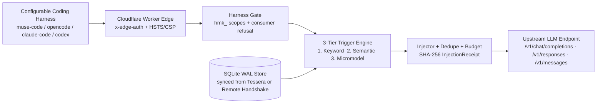

# Architecture

Herma separates pure schema and trigger evaluation from storage, payload mutation, and HTTP edge lockdown:

## Components

- `herma/errors.py` — RFC 9457 `problem+json` error hierarchy.
- `herma/schemas.py` — strict Pydantic v2 models for provisions, URIs, triggers, harness keys, and receipts.
- `herma/harness_gate.py` — constant-time `hmk_` verification, consumer-surface refusal, `configure` harness attestation, and `-contributor` refusal.
- `herma/triggers/` — `keyword.py`, `semantic.py`, `micromodel.py`, and `engine.py`.
- `herma/store.py` — SQLite WAL store, compare-and-set updates, Tessera CAS/blob sync, and remote handshake sync.
- `herma/injector.py` — multi-protocol envelope extraction, provision formatting, turn deduplication, and SHA-256 receipts.
- `herma/proxy.py` — upstream forwarding (JSON and streaming SSE) with allowlisted upstream hosts.
- `herma/api/` — FastAPI app (`:7730`) with `HERMA_EDGE_SECRET` lockdown and server-rendered read-only pages.

## Invariants

| Id | Always true | Checked by |
|---|---|---|
| H01 | Generic consumer chat assistants, browser navigation requests, and cookie-authenticated calls are deterministically refused | `test_consumer_assistant_and_browser_navigation_refused`, `test_http_edge_lockdown_and_dry_run_across_wire_formats` |
| H02 | Provision management and remote sync require both configure scope and explicit matching X-Herma-Harness attestation | `test_consumer_assistant_and_browser_navigation_refused`, `test_route_only_key_cannot_configure` |
| H03 | Contributor-tier models (-contributor) are refused across outbound LLM payloads and micromodel trigger classifiers | `test_tier3_micromodel_classifier_and_contributor_refusal`, `test_http_edge_lockdown_and_dry_run_across_wire_formats` |
| H04 | Tier-1 keyword, bounded regex, path-glob, and tool-name triggers match deterministically without network calls | `test_tier1_keyword_regex_path_and_tool_triggers` |
| H05 | Tier-2 semantic triggers match paraphrased intent without literal keyword overlap | `test_tier2_semantic_paraphrase_without_literal_id` |
| H06 | Tier-1 or Tier-2 hits short-circuit Tier-3 micromodel calls when trigger mode is any | `test_engine_short_circuits_micromodel_when_keyword_matches` |
| H07 | Compare-and-set versions prevent silent provision overwrites, Tessera blob URIs resolve deterministically, and remote handshakes clamp max_chars | `test_cas_conflict_and_tessera_blob_sync`, `test_remote_handshake_clamps_max_chars` |
| H08 | Multi-turn conversations deduplicate once_per_conversation provisions and HERMA_EDGE_SECRET blocks direct origin traffic lacking x-edge-auth | `test_http_edge_lockdown_and_dry_run_across_wire_formats` |
