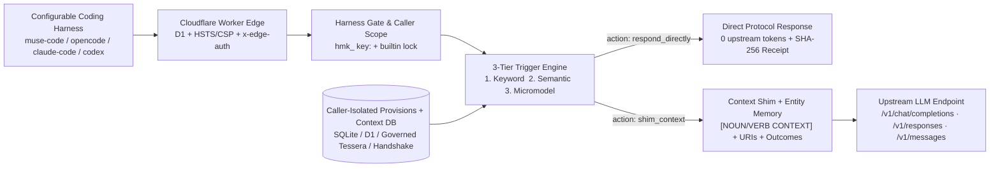

# Architecture

**Herma:** context-shimming AI middleware for configurable coding harnesses -- intercepts requests via keyword, semantic, or micromodel rules to respond directly or shim atomic Task Object, Task, and URI context from a user-configured database before LLM execution.

## Components

- `herma/errors.py` -- RFC 9457 `problem+json` error hierarchy (`403 harness_required`, `403 admin_required`, `403 builtin_protected`, `403 contributor_tier_refused`, `409 version_conflict`).
- `herma/schemas.py` -- strict Pydantic v2 models for `Provision` (`shim_context` / `respond_directly` + `context_refs`), `ContextEntry` (`noun` / `verb` / `detail` + `version`), `WorkingEntity`, `RuleOutcomeRecord`, `InsightsResponse`, `DryRunResponse`, and `InjectionReceipt`.
- `herma/harness_gate.py` -- constant-time `hmk_` verification, `caller_scope = key:<key_id>`, credentialed personal-assistant access, `configure` harness attestation, and refusal of any model ID containing `contributor`.
- `herma/triggers/` -- `keyword.py`, `semantic.py`, `micromodel.py`, and `engine.py`.
- `herma/memory.py` -- zero-LLM deterministic entity extraction (`file_path`, `code_symbol`, `tessera_uri`, `statute_card_id`, `error_signature`) and reviewable `candidate_provisions` synthesis.
- `herma/store.py` -- caller-partitioned SQLite WAL store (`provisions`, `context_entries`, `harness_keys`, `injection_receipts`, `working_entities`, `rule_outcomes`), single-statement atomic SQL CAS, Layer-1 Governance Lens + SHA-256 blob verification, Tessera store sync, and remote handshake sync.
- `herma/injector.py` -- multi-protocol envelope extraction, `[NOUN/VERB CONTEXT]` rendering, direct-response assembly, turn deduplication, entity extraction, and SHA-256 receipts.
- `herma/proxy.py` -- direct-response short-circuiting (`chat.completion`, `response`, `message`), turn telemetry persistence, and upstream forwarding (JSON and streaming SSE).
- `herma/api/` -- FastAPI app (`:7730`) serving caller-isolated `/v1/*` endpoints, `/v1/memory`, `/v1/outcomes`, `/v1/insights`, read-only `POST /api/preview`, stateless JSON-RPC 2.0 `POST /mcp`, discovery routes (`/llms.txt`, `/llms-full.txt`, `/.well-known/agent-card.json`, `/robots.txt`, `/healthz`, `/favicon.svg`), and responsive SVG-branded HTML pages.
- `deploy/cloudflare/` -- 24/7 native Cloudflare Worker + D1 (`ta-amps-herma`) + `TESSERA` Service Binding with full caller-isolation, CAS, governance lens, entity memory, preview, and MCP parity.

## Invariants

| Id | Always true | Checked by |
|---|---|---|
| H01 | Personal assistants with scoped keys are accepted; browser navigation and cookie authentication are refused | `test_personal_assistant_credentials_and_browser_navigation`, `test_http_edge_lockdown_and_dry_run_across_wire_formats` |
| H02 | Provision management and remote sync require both configure scope and explicit matching X-Herma-Harness attestation | `test_personal_assistant_credentials_and_browser_navigation`, `test_route_only_key_cannot_configure` |
| H03 | Contributor-tier models (any model ID containing contributor, including -contributor) are refused across outbound LLM payloads, micromodel trigger classifiers, provider plans and operator grants before offline fallback | `test_tier3_micromodel_classifier_and_contributor_refusal`, `test_http_edge_lockdown_and_dry_run_across_wire_formats`, `test_governance_lens_blob_sha256_integrity_and_contributor_offline_refusal`, `test_contributor_models_are_refused_in_plans_grants_and_configuration` |
| H04 | Tier-1 keyword, bounded regex, path-glob, and tool-name triggers match deterministically without network calls | `test_tier1_keyword_regex_path_and_tool_triggers` |
| H05 | Tier-2 semantic triggers match paraphrased intent without literal keyword overlap | `test_tier2_semantic_paraphrase_without_literal_id` |
| H06 | Tier-1 or Tier-2 hits short-circuit Tier-3 micromodel calls when trigger mode is any | `test_engine_short_circuits_micromodel_when_keyword_matches` |
| H07 | Single-statement atomic SQL compare-and-set versions prevent silent provision and context_entries overwrites, Tessera blob URIs verify SHA-256 digests, and remote handshakes clamp max_chars | `test_cas_conflict_and_tessera_blob_sync`, `test_remote_handshake_clamps_max_chars`, `test_multi_caller_non_poisoning_builtin_lock_admin_keys_and_cas_parity` |
| H08 | Multi-turn conversations deduplicate once_per_conversation provisions and HERMA_EDGE_SECRET blocks direct origin traffic lacking x-edge-auth | `test_http_edge_lockdown_and_dry_run_across_wire_formats` |
| H09 | Matched context_refs shim bounded atomic noun, verb, and detail entries from caller-scoped context_entries or governed Tessera stores and record shimmed_context_refs in the receipt | `test_store_context_entries_and_tessera_noun_verb_resolution`, `test_api_context_database_and_noun_verb_shimming` |
| H10 | Provisions with action=respond_directly return protocol-faithful completions across chat_completions, responses, and messages without invoking upstream LLM transport while recording a SHA-256 receipt | `test_direct_response_short_circuits_upstream_across_all_protocols`, `test_cloudflare_worker_context_shim_and_direct_response_parity` |
| H11 | Caller-scoped provisions, context_entries, and receipts never poison or leak across keys, system_builtin records return 403 builtin_protected on non-admin writes, and /v1/admin/keys requires bootstrap/admin credentials | `test_multi_caller_non_poisoning_builtin_lock_admin_keys_and_cas_parity` |
| H12 | Layer-1 Tessera governance refuses status:quarantined records, requires status:verified across surfaces, enforces visibility_scope/cohort/harness tags, and verifies 64-hex SHA-256 digests on tessera://blobs URIs | `test_governance_lens_blob_sha256_integrity_and_contributor_offline_refusal` |
| H13 | Deterministic regex extraction tracks 5 entity kinds per (caller_scope, project_tag), attributes Turn N error signatures to Turn N-1 fired rules as retry_error, and emits Provision-valid candidate_provisions without mutating active rules | `test_deterministic_entity_memory_retry_outcomes_and_candidate_insights_parity` |
| H14 | Public POST /api/preview evaluates system_builtin rules with persisted=false, SVG brand chrome renders cleanly, and discovery routes plus stateless JSON-RPC POST /mcp match across Python and Cloudflare Worker | `test_public_preview_svg_brand_chrome_discovery_and_stateless_mcp_parity` |
| H16 | Micromodel decisions require boolean apply and finite numeric confidence in [0,1], malformed replies do not activate fallback, and offline trigger evaluation skips classifier and remote embedding requests | `test_micromodel_requires_typed_decision`, `test_malformed_model_reply_does_not_activate_fallback`, `test_offline_engine_blocks_all_provider_calls`, `test_preview_and_dry_run_never_call_configured_trigger_providers`, `test/triggers.test.js` |
| H17 | Operator-funded conversation turns require the caller's own exact provider/model grant; uncertain-outcome failover requires that caller's grant plus the plan opt-in; one upstream model identity is reachable through one route per plan and is held against other routes during its rate or quota limit | `test_direct_turns_need_the_callers_own_exact_grant`, `test_uncertainty_grant_defaults_off_and_a_plan_cannot_supply_it`, `test_plans_refuse_a_second_credential_for_the_same_upstream_model`, `test_rate_limit_holds_the_upstream_model_against_other_credentials`, `test/provider_grants.test.js` |
| H18 | Served pages, discovery text, starter seed data and runtime sources never name a retired pack, and fabric imports trust only the current producer surfaces: Tessera, Herma, Eranos and Agora | `test_served_text_names_no_retired_pack`, `test_seed_data_and_runtime_sources_name_no_retired_pack`, `test_governance_lens_trusts_the_same_producer_surfaces` |
| H19 | Starters synced from Tessera into system_builtin fire for routed callers only when they carry fabric_governance that passes the Layer-1 lens, and Python and the Worker decide every stored row the same way | `test_synced_starters_fire_for_routed_callers_only_with_their_governance`, `test_stored_provisions_pass_the_lens_the_same_way` |
| H20 | Served pages, public JSON and shipped files pass the ONE shared banned-word list, which is read from outside this repository and never copied into it (MUST-FOLLOW rule 16), and the public model list comes from one catalog that the Python and Worker pages render identically with agent programs kept out of the model table | `test_models_section_and_text_are_identical_in_both_runtimes`, `test_served_pages_and_public_json_pass_the_shared_banned_word_list`, `test_repository_holds_no_word_that_is_banned_everywhere`, `test_agent_apps_are_named_nowhere_in_the_repository`, `test_home_page_has_no_receipt_or_hash_wording`, `test_live_gateway_routes_keep_working_and_name_the_muse_default` |
| H21 | Herma routes only catalog models that carry a standard-mode price ceiling, its default upstream and allowlist lead with the Meta API in both runtimes, and no catalog entry is a contributor-tier id | `test_catalog_lists_meta_models_first_and_keeps_agent_programs_out`, `test_routed_models_are_exactly_the_priced_models_in_both_runtimes`, `test_routing_defaults_point_at_the_meta_api_and_agree_across_runtimes` |
| H22 | Every public Herma page is light only (color-scheme only light in its meta tag and on :root, no dark-scheme media query, no opaque dark panel under either colour scheme), carries the one thin agent banner, the header and the standard footer (the shared ta-amps.footer/1 spec: the brand and one row of links, then one short line) from a single shell (herma/page_shell.json) that the Python and Worker renderers produce byte for byte alike, and shows worker-written text only after the display-time filter (tidyText), which is built on the server from the shared banned-word list and never sent to a browser, and never alters a stored record | `test_python_and_worker_shells_are_byte_identical`, `test_footer_is_the_shared_standard_one_row_of_links_and_one_short_line`, `test_stylesheet_is_light_only_and_text_is_never_small`, `test_every_page_carries_the_shell_and_stays_light`, `test_every_page_uses_plain_words`, `test_worker_written_text_is_filtered_by_the_list_and_the_original_stays_in_the_record`, `test_no_script_a_browser_receives_carries_the_word_rules`, `test_the_light_check_fails_on_every_kind_of_dark_page`, `test_the_light_check_passes_on_every_redesigned_page`, `test_the_fixture_pages_are_served_with_the_workers_real_page_policy` |
| H23 | A deploy of the Worker from any checkout of this repository is refused unless the tree is clean, the commits listed in deploy/cloudflare/release-policy.json (the one that is live and the Muse-first release) are contained in HEAD, the page asset versions are current, the word-list module comes from the shared banned-word list and not from an override, the banned-word gate passes that list on every served surface (and fails closed without it), and the light check passes | `test_a_dirty_or_untracked_tree_is_refused`, `test_the_commit_that_is_live_must_be_contained`, `test_the_policy_names_the_live_commit_and_this_history_contains_it`, `test_wrangler_runs_the_guard_and_the_light_check_before_every_deploy`, `test_the_gate_fails_on_every_kind_of_dirty_page_and_passes_a_clean_one`, `test_the_gate_fails_closed_without_the_list_and_with_samples_that_catch_nothing`, `test_a_release_ignores_overrides_of_the_word_list`, `test_the_gate_reads_the_lists_fingerprints_group_and_keeps_its_own_floor`, `test/node/banned_list.node-test.mjs`, `test_a_footer_link_to_a_page_that_is_not_there_stops_the_release` |
| H24 | A /q/help request reserves its Meta call in one atomic statement before it makes it (the daily call cap, the public day cap and the total budget are checked together against the worst-case cost of the prompt), settles the same row afterward, and counts failed and uncertain attempts, so a burst of simultaneous requests cannot spend past a cap | `test/node/help_burst.node-test.mjs` |
| H25 | Herma keeps no visitor address and no full browser string: persisted traces and automatic request logs are off, the trace log and the bridge records keep a coarse client family, and nothing is derived from an address | `test/privacy_logs.test.js`, `test_the_worker_keeps_no_persisted_traces_and_no_invocation_logs` |
| H26 | The network map keeps per claim only the Cloudflare data center and continent (never an IP address, city, coordinate, network or user agent; none at all for a worker that left the map) for 30 days and then only a count per day and continent; it names a claim's data center only when 2 or more workers of its kind made claims there in the 15 minutes up to it, one decision per claim for the feed, the replay and the place list; it shows only claims of public Tasks (any other claim counts in the totals only); it accepts Tessera's data centers and rows only as far as Tessera's own counts and per-row marks show them; a worker's show_on_map changes only with that worker's token or in the call that creates the worker; and it answers GET /q/network cached for 15 seconds to the five contract origins, with a generous cap per address | `test/network_activity.test.js`, `test/node/network_merge.node-test.mjs`, `test/node/network_merge_hostile.node-test.mjs` |
| H27 | Herma has one canonical host, herma.teleionlabs.com: any other host that reaches the Worker is answered with a redirect that keeps the path and the query (301 for GET and HEAD, 308 for every other method, so an agent's POST to /q/* keeps its method and body), and every page that exists names rel=canonical | `test/canonical_host.test.js`, `test_every_existing_page_names_the_canonical_host` |
| H28 | What an agent shows its person after it reports a Task is two plain lines written by the server (links to the Task Object, the worker and the dashboard, then the next turn), with no hash and no receipt | `test/contributor_printout.test.js`, `test/priority_work_gateway.test.js` |
| H29 | The home, Get started and Trust & safety pages are rendered from one content Task Object (herma/page_content.json) by both runtimes, byte for byte alike | `test_home_get_started_and_trust_are_the_same_in_both_runtimes`, `test_the_home_says_what_herma_is_and_shows_today_s_numbers` |
